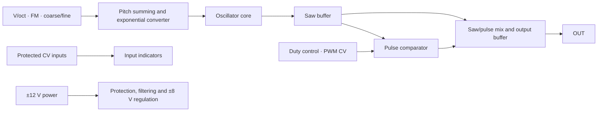
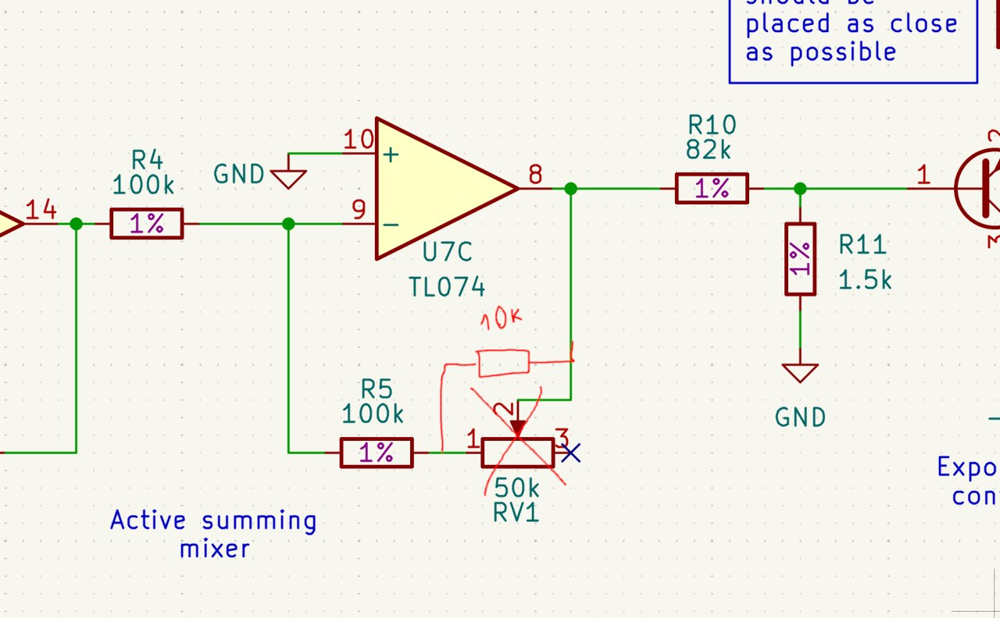
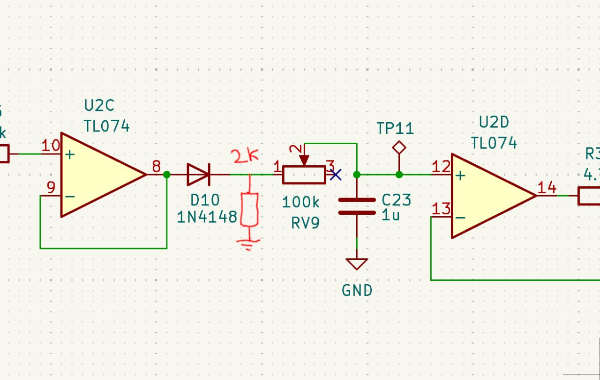
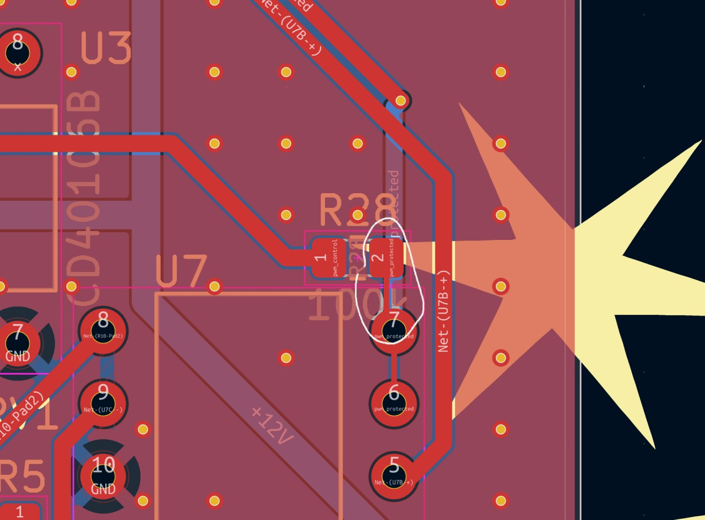

# μVCO - voltage-controlled oscillator for a modular synthesizer

> **AI use.** The authors use AI for additional validation, component research, testbench setup and simulation, intermediate design reviews, release setup, and assistance with KiCad and 3D model edits. The authors developed the original designs and schematics manually, and other people reviewed them. The authors make the technical and visual decisions and take responsibility for them.

uvco is a voltage-controlled oscillator for a modular synthesizer.
Rev1 has a published manufacturing release. Rev2 is a work in progress.

## Hardware projects

| Board | Purpose | Design | Simulation |
| --- | --- | --- | --- |
| Rev1 | Saw and pulse oscillator with PWM | [KiCad project](hardware/rev1/uvco_rev1.kicad_pro) | |
| Rev2 | Analog oscillator with saw, triangle, and sine shaping | [KiCad project](hardware/rev2/uvco_rev2.kicad_pro) | [ngspice bench](sim/rev2/) |

## rev1

Rev1 combines exponential pitch control with a CD40106B oscillator core and a buffered mix of saw and pulse waves. The front panel provides coarse and fine tuning, V/oct and attenuated FM inputs, and manual duty and PWM controls.

Rev1 accepts ±12 V through a 10-pin header. The 78L08 and 79L08 regulators supply the ±8 V analog rails. TL074 amplifiers handle control summing, signal conditioning, mixing, and indication. BC847C and BC857C transistors form part of the discrete control circuit. Test points and indicators support bring-up and calibration.

[Rev1 release](https://github.com/Coestaris/hw-uvco/releases/tag/rev1)

Top and bottom views

| File | Download |
| --- | --- |
| Schematic PDF | [uvco_rev1-schematic.pdf](https://github.com/Coestaris/hw-uvco/releases/download/rev1/uvco_rev1-schematic.pdf) |
| PCB PDF | [uvco_rev1-pcb.pdf](https://github.com/Coestaris/hw-uvco/releases/download/rev1/uvco_rev1-pcb.pdf) |
| Gerbers and drill files | [uvco_rev1-gerbers.zip](https://github.com/Coestaris/hw-uvco/releases/download/rev1/uvco_rev1-gerbers.zip) |
| JLCPCB BOM | [uvco_rev1-jlcpcb-bom.csv](https://github.com/Coestaris/hw-uvco/releases/download/rev1/uvco_rev1-jlcpcb-bom.csv) |
| JLCPCB placement | [uvco_rev1-jlcpcb-pnp.csv](https://github.com/Coestaris/hw-uvco/releases/download/rev1/uvco_rev1-jlcpcb-pnp.csv) |
| 3D assembly model | [uvco_rev1.stpz](https://github.com/Coestaris/hw-uvco/releases/download/rev1/uvco_rev1.stpz) |

#### Hardware bring-up

At first power-up, the oscillator core produced high-frequency, low-amplitude noise, with almost no signal at the output. The prototype needed three fixes.

1. **Pitch control feedback.** The original RV1 configuration prevented normal oscillation. Replacing RV1 with a 10 kΩ resistor in series with R5 in U7C’s feedback loop restored oscillation.

   

   
RV1 feedback schematic

   

   

2. **Signal LEDs.** A 2 kΩ pull-down from the cathode of D10 to ground gave C23 a discharge path through RV9 when the signal was absent, restoring LED indication.

   

   
LED discharge schematic

   

   

3. **Duty-cycle control.** A PCB etching defect affected the `pwm_protected` trace between R28 pad 2 and U7 pin 7. Repairing the connection restored duty-cycle control.

   

   
PWM trace on the PCB

   

   

#### Bench test results

- **Frequency range.** The repaired board produced usable waveforms from about 60 Hz up to 6–7 kHz. Above that range, the frequency jumped sharply and the oscillator saturated.
- **Pulse duty cycle.** The control adjusted the pulse width smoothly and predictably over nearly the full 0–100% range.
- **Output offset.** Changing the frequency produced a small baseline shift at the AC-coupled output.
- **Pitch tracking.** Tuning was coarse and temperature-dependent, limiting its accuracy for musical intervals.

## rev2

The Rev2 oscillator uses a matched DMMT3904 transistor pair for exponential current control. An integrator generates a sawtooth ramp, and a comparator triggers the reset. A triangle shaper feeds the LM13700 sine shaper. The design accepts ±12 V and derives local reference rails.

The ngspice bench includes frequency, sensitivity, and stability sweeps. The full oscillator-to-sine simulation sustained oscillation at all 37 control-voltage points tested.
