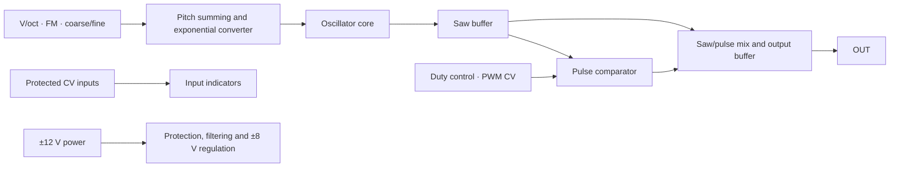

# VCO1

VCO1 is a voltage-controlled oscillator for a modular synthesizer. It combines
exponential pitch control, a CD40106B oscillator core, saw and pulse signal paths,
and a mixed audio output. Coarse/fine tuning, frequency modulation, and
pulse-width modulation are exposed through the front-panel controls and CV inputs.

## Goals

- Control pitch from a V/oct input and an attenuated FM input, alongside coarse
  and fine tuning.
- Shape the pulse waveform with manual duty control and an attenuated PWM CV input.
- Mix the saw and pulse signals into one buffered output.
- Support bring-up and calibration with test points, a power indicator, and
  indicators for the pitch, FM, and PWM inputs.
- Keep the circuit, PCB, required component models, and manufacturing files usable
  independently of the private AI toolset.

## Architecture

The board takes ±12 V power through a 10-pin header. Input protection, filtering,
and 78L08/79L08 regulators provide the ±8 V analog rails. TL074 amplifiers handle
control summing, signal conditioning, mixing, and indication; BC847C/BC857C
transistors form part of the discrete control circuitry.

The schematic is organized into four sheets:

| Sheet | Role |
| --- | --- |
| [Power and project root](hardware/rev1/vco1_rev1.kicad_sch) | Supply input, protection, regulation, and decoupling. |
| [Signal](hardware/rev1/signal.kicad_sch) | Exponential converter, oscillator core, saw buffer, pulse comparator, and mixing/buffering. |
| [I/O](hardware/rev1/io.kicad_sch) | Audio/CV jacks, input protection, and tuning, modulation, and mix controls. |
| [Indication](hardware/rev1/indication.kicad_sch) | Power and input-signal indicators. |

## Interfaces and controls

| Interface | Purpose |
| --- | --- |
| V/OCT IN | Pitch-control voltage input. |
| FM IN | Frequency-modulation input with attenuation. |
| PWM CV IN | Pulse-width control input with attenuation. |
| OUT | Mixed saw/pulse output. |
| Front-panel controls | Coarse tuning, fine tuning, PWM duty, FM attenuation, PWM CV attenuation, and mix level. |
| Power header | ±12 V supply and ground. |

## Rev1 board

These views are rendered from the rev1 manufacturing PCB PDF using the actual
board and component models.

| Top | Bottom |
| --- | --- |
|  |  |

## Rev1 manufacturing release

The [rev1 release](https://github.com/Coestaris/hw-vco1/releases/tag/rev1)
contains the validated manufacturing package:

| File | Use |
| --- | --- |
| [Schematic PDF](https://github.com/Coestaris/hw-vco1/releases/download/rev1/vco1_rev1-schematic.pdf) | Four-sheet circuit reference. |
| [PCB PDF](https://github.com/Coestaris/hw-vco1/releases/download/rev1/vco1_rev1-pcb.pdf) | Layer plots and three 3D board views. |
| [Gerber and drill ZIP](https://github.com/Coestaris/hw-vco1/releases/download/rev1/vco1_rev1-gerbers.zip) | PCB fabrication files. |
| [3D assembly, STPZ](https://github.com/Coestaris/hw-vco1/releases/download/rev1/vco1_rev1.stpz) | Mechanical assembly reference. |
| [JLCPCB BOM](https://github.com/Coestaris/hw-vco1/releases/download/rev1/vco1_rev1-jlcpcb-bom.csv) | Assembly parts list. |
| [JLCPCB placement CSV](https://github.com/Coestaris/hw-vco1/releases/download/rev1/vco1_rev1-jlcpcb-pnp.csv) | Assembly positions and rotations. |

## Working with the hardware

Clone this repository and run `git lfs pull`, then open
[`hardware/rev1/vco1_rev1.kicad_pro`](hardware/rev1/vco1_rev1.kicad_pro) in KiCad 10.
The project includes its required models and datasheets under `assets/`;
initializing `infra/` is optional for ordinary KiCad work.

Maintainer setup, AI tooling, and release automation are described in
[development notes](docs/development.md). The private `infra/` submodule owns the
tooling, catalog seed, reusable actions, and release image. Future mechanical and
software work belongs in `mechanical/` and `software/`.
