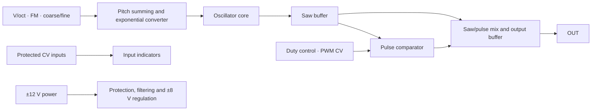

# VCO1

Rev1 has a published manufacturing release. VCO1 is a voltage-controlled oscillator for a modular synthesizer.

> **AI use.** The authors use AI for additional validation, component research, testbench setup and simulation, intermediate design reviews, release setup, and assistance with KiCad and 3D model edits. The authors developed the original designs and schematics manually, and other people reviewed them. The authors make the technical and visual decisions and take responsibility for them.

## Goals and architecture

VCO1 combines exponential pitch control with a CD40106B oscillator core and a buffered mix of saw and pulse waves. The front panel provides coarse and fine tuning, V/oct and attenuated FM inputs, and manual duty and PWM controls.

The board accepts ±12 V through a 10-pin header. The 78L08 and 79L08 regulators supply the ±8 V analog rails. TL074 amplifiers handle control summing, signal conditioning, mixing, and indication. BC847C and BC857C transistors form part of the discrete control circuit. Test points and indicators support bring-up and calibration.

## Hardware projects

| Board | Purpose | Design | Simulation |
| --- | --- | --- | --- |
| rev1 | Modular synthesizer oscillator | [KiCad project](hardware/rev1/vco1_rev1.kicad_pro) | — |

### rev1 - modular synthesizer oscillator

Rev1 groups power, signal generation, panel I/O, and indicators on four schematic sheets. [Rev1 release](https://github.com/Coestaris/hw-vco1/releases/tag/rev1)

Top and bottom views

| File | Download |
| --- | --- |
| Schematic PDF | [vco1_rev1-schematic.pdf](https://github.com/Coestaris/hw-vco1/releases/download/rev1/vco1_rev1-schematic.pdf) |
| PCB PDF | [vco1_rev1-pcb.pdf](https://github.com/Coestaris/hw-vco1/releases/download/rev1/vco1_rev1-pcb.pdf) |
| Gerbers and drill files | [vco1_rev1-gerbers.zip](https://github.com/Coestaris/hw-vco1/releases/download/rev1/vco1_rev1-gerbers.zip) |
| JLCPCB BOM | [vco1_rev1-jlcpcb-bom.csv](https://github.com/Coestaris/hw-vco1/releases/download/rev1/vco1_rev1-jlcpcb-bom.csv) |
| JLCPCB placement | [vco1_rev1-jlcpcb-pnp.csv](https://github.com/Coestaris/hw-vco1/releases/download/rev1/vco1_rev1-jlcpcb-pnp.csv) |
| 3D assembly model | [vco1_rev1.stpz](https://github.com/Coestaris/hw-vco1/releases/download/rev1/vco1_rev1.stpz) |
